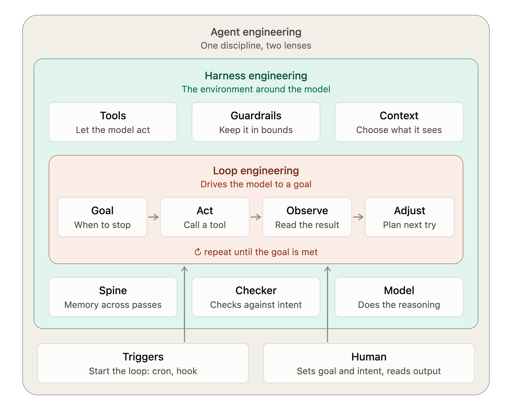

# Harness Engineering, Hands On

A small, complete, runnable demo of **harness engineering**: the code that
sits around a model and turns "call an LLM" into an agent you can trust with
real work.

The agent's job is ordinary: fix bugs in a tiny checkout service (Indian
store, GST invoices, discount codes). The interesting part is everything
around the model. It's built up in eight layers, and each one can be switched
off, so you can watch what goes wrong without it.



The loop is **goal → act → observe → adjust → repeat**. The harness is
everything that makes that loop safe and useful: what the model may touch,
who decides "done", what survives a crash, what the model is allowed to
forget, who reviews the work, what rules it's judged by, which human signs
off, and how the whole thing gets better over time.


## The eight layers

| Stage | Layer | The question it answers | Code | Guide |
|---|---|---|---|---|
| 0 | Playground | What may the agent touch? | [tools.py](harness/tools.py), [scenario.py](harness/scenario.py) | [stage0](exercises/stage0.md) |
| 1 | Bare loop | How does act → observe → adjust work in code? | [loop.py](harness/loop.py) | [stage1](exercises/stage1.md) |
| 2 | Goal | Who decides "done": the model, or code? | [goal.py](harness/goal.py) | [stage2](exercises/stage2.md) |
| 3 | Spine | What survives a crash? | [spine.py](harness/spine.py) | [stage3](exercises/stage3.md) |
| 4 | Context | What may the model forget, and when? | [loop.py](harness/loop.py) `compact_history` | [stage4](exercises/stage4.md) |
| 5 | Checker | Is the change *allowed*, not just passing? | [checker.py](harness/checker.py) | [stage5](exercises/stage5.md) |
| 6 | Intent | What rules is it judged by, and who writes them? | [INTENT.md](INTENT.md) | [stage6](exercises/stage6.md) |
| 7 | Human gate | Does anyone understand the change? | [gate.py](harness/gate.py) | [stage7](exercises/stage7.md) |
| 8 | Outer loop | How does the harness learn from past runs? | [reflect.py](harness/reflect.py), [experiment.py](harness/experiment.py) | [stage8](exercises/stage8.md) |

Every layer is on by default. Each stage's guide shows the flags that turn
the later layers off, so you can see that stage on its own.

## Rails around every stage

| Rail | What it does | Code |
|---|---|---|
| Sandbox | actor-written code runs in a container with no network, read-only code and capped resources (`--sandbox docker`; local by default, with a warning) | [sandbox.py](harness/sandbox.py) |
| Fixed rules | free deterministic checks before the checker: CATALOG unchanged, no rejection removed (deliberately narrow; the checker covers the rest) | [sensors.py](harness/sensors.py) |
| Budgets | passes, dollars, minutes and rejected reviews; running out → `ESCALATED`, handed to a human | [budget.py](harness/budget.py) |
| Trace | every model call, tool call, verdict and cost as JSON lines, one file per run | [trace.py](harness/trace.py) |
| Checker eval | the checker's own test suite: known diffs, expected verdicts, pass^k | [checker_eval.py](harness/checker_eval.py) |

Acceptance always runs cheapest first: **tests → fixed rules → checker →
human**.

## Quickstart

You need Python 3.10+, git, and an Anthropic API key (`ANTHROPIC_API_KEY`,
or `ant auth login`).

```
git clone <this repo> && cd harness-loop-engineering
python3 -m venv .venv && source .venv/bin/activate
pip install -r requirements.txt

python -m pytest selftest            # the harness checks itself: no API calls, ~15s
python -m harness.scenario apply broken
python -m pytest -q tests            # 4 failed, 10 passed: the agent's starting point
python -m harness.loop --fresh       # the full harness; you'll be asked to explain each fix
python -m harness.trace show latest  # what that run did, pass by pass, and what it cost
```

A full run takes a minute or two and a few cents of API usage: Sonnet as the
actor, Haiku as the checker. Stage 8's experiment runs the loop 12 times with
Haiku and makes one Opus call. By default no model call starts once a run
has spent $1.00 (`--max-cost`); a single call can take it slightly over.

## Safety

The actor can only *write* `checkout/*.py`, but the tests then *run* what it
wrote. By default that happens on your machine, and every run starts with a
warning that says so. To isolate it, build the sandbox once and add
`--sandbox docker`:
```
python -m harness.sandbox build
python -m harness.loop --fresh --sandbox docker
```
In docker mode the tests and the audit run with no network, read-only code,
512 MB of memory, one CPU and a non-root user. If Docker isn't available,
the run doesn't start; it never falls back to local by itself.

## Repo map

| Path | What it is |
|---|---|
| `checkout/` | the system under repair, committed **green** (working) |
| `tests/` | the 14 visible tests: the oracle the loop stops on |
| `INTENT.md` | the business rules the tests can't express; the actor and checker both read it |
| `harness/` | the harness: every layer, one file each |
| `scenarios/` | starting states (bug patches), cheat diffs, intent variants, and the hidden audit |
| `selftest/` | offline tests of the harness itself: a fake model and a scripted human |
| `sandbox/` | the Dockerfile for `--sandbox docker` |
| `PRACTICES.md` | how this repo maps to published harness-engineering practice, with sources |
| `exercises/` | one guide per stage: the idea, the code, how to run it, things to try |
| `results/` | real recorded runs from stages 0-6, with notes and numbers |
| `assets/` | diagrams, and the [scripts that draw them](assets/gen/README.md) |
| `.harness/`, `runs/` | local run state (spine, traces, escalations) and raw output, gitignored |

## What the agent can and can't see

The actor sees `checkout/`, `tests/` and `INTENT.md`, and nothing else. It
can write only `checkout/*.py`, and `run_tests` takes no arguments, so the
only way to green is to change product code. The harness, the scenarios and
the audit don't exist from its point of view. See [stage 0](exercises/stage0.md).

## Principles this demo makes concrete

1. **Code decides "done", not the model** (stage 2). A goal you can't check
   is a goal you take on trust.
2. **Persist decisions, not transcripts** (stage 3). The model can always
   re-read a file. It can't recover a decision.
3. **Measure context management in money and passes** (stage 4). Fewer input
   tokens can cost more.
4. **Tests say it works; a reviewer says it's allowed** (stage 5). Use a
   different model with no tools and a typed verdict, and fail closed.
5. **A rule that isn't written down can't be enforced** (stage 6). Intent
   debt is invisible until a worse fix arrives.
6. **Cheapest check first, human last** (stage 7). Tests take milliseconds,
   the checker cents, a human minutes.
7. **Learn on one set, measure on another** (stage 8). An outer loop that is
   graded on what it learned from is just memorising.
8. **The learner never edits its own oracle** (stages 2 and 8). Lessons and
   rules go through a human; tests, tools and the goal stay fixed.
9. **Code catches what code can** (stage 5). Deterministic rules run before
   any model is asked, and the model-based checker has its own test suite.
10. **Limits belong to the harness** (every stage). Passes, money, time and
   rejections are capped by code, and running out escalates to a person
   instead of failing quietly.
11. **Untrusted code runs in a box** (stage 0). The tools limit what the
   agent writes; the sandbox limits what that code can do.

## Credits

Inspired by IBM Technology's *What Is Loop Engineering?* and built on the
[Anthropic API](https://docs.claude.com). MIT licensed.
