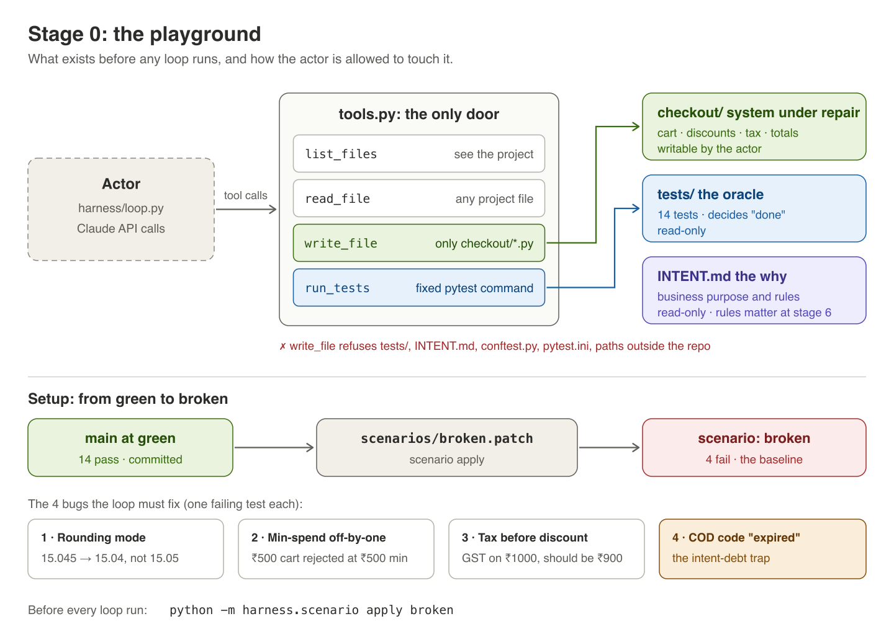

# Stage 0: the playground



**The idea.** Before there's a loop, there's a sandbox. The harness decides
what the model can see, what it can change, and how "passing" is measured,
and none of those can be up to the model. If the actor could edit the tests,
"make the tests pass" would be one line of work.

## In the code
| Piece | Where | What it guarantees |
|---|---|---|
| 4 tools | [harness/tools.py](../harness/tools.py) `TOOLS` | `list_files`, `read_file`, `write_file`, `run_tests`, all with strict schemas |
| Visibility | `tools._is_visible` | the actor sees `checkout/`, `tests/`, `INTENT.md`, and nothing else |
| Write allowlist | `tools._resolve_writable` | only `checkout/*.py`; tests and intent are read-only |
| Fixed oracle | `tools.run_tests` | `pytest tests/` with fixed arguments; the model can't choose what "pass" means |
| Scenarios | [harness/scenario.py](../harness/scenario.py) | `checkout/` is committed green; a scenario is a patch on top, snapshotted as the baseline |
| System under repair | [checkout/](../checkout/), [tests/](../tests/) | 4 small modules, 14 tests |
| Sandbox | [harness/sandbox.py](../harness/sandbox.py), [sandbox/Dockerfile](../sandbox/Dockerfile) | where actor-written code *runs*: locally (default, with a warning) or in a container with no network, read-only code and capped resources |

## Run it
```
python -m harness.scenario list
python -m harness.scenario apply broken
python -m pytest -q tests                  # 4 failed, 10 passed
python -m harness.scenario status
python -m harness.scenario apply green     # and back: 14 passed
```

Poke the guardrails the way the model would:
```
python -c "from harness.tools import execute_tool as t; print(t('write_file', {'path': 'tests/test_cart.py', 'content': ''}))"
python -c "from harness.tools import execute_tool as t; print(t('read_file', {'path': 'scenarios/broken.patch'}))"
python -c "from harness.tools import execute_tool as t; print(t('list_files', {}).content)"
```

Then run the same tests where the actor's code can't reach anything:
```
python -m harness.sandbox build                       # once
python -m harness.sandbox check
python -m pytest -q selftest -k docker            # the self-test that runs tests + audit in the box
python -m harness.loop --fresh --sandbox docker       # any loop run, in the box
```

## Why the sandbox matters
The tools stop the actor from *writing* tests or the harness, but pytest
then *imports* whatever it wrote into `checkout/`. Without a sandbox, that
code runs as you, with your files and your network. In docker mode the
tests and the audit run in a throwaway container. If Docker or the image is
missing, the run doesn't start; it never falls back to local by itself.

## What happened when we ran it
[results/stage0/](../results/stage0/): the green and broken test runs, and
a guardrail check that tried the obvious escapes: writing tests, `INTENT.md`,
`conftest.py` or `pytest.ini`, `checkout/../tests/`, a path outside the repo,
reading `.git/config`, and an unknown tool. Every one was refused.

## Try this
1. **Leak the harness.** Add `"scenarios"` to `VISIBLE_DIRS` in `tools.py`
   and list files. The bug patch is now one `read_file` away from the actor.
   That's a harness bug, not a model bug. Put it back.
2. **Read the four bugs.** `cat scenarios/broken.patch`. Which ones would the
   14 tests catch if they were written slightly differently? (Bug 4 comes
   back in stage 6.)
3. **Try to escape.** The actor's code runs when the tests import it, so
   put the escape at the top of a module they import. Add
   `import urllib.request; urllib.request.urlopen("https://example.com", timeout=5)`
   to the top of `checkout/tax.py` and run `python -m pytest -q tests`: it
   works. Now run the same tests in the box,
   `HARNESS_SANDBOX=docker python -c "from harness.tools import run_tests; print(run_tests().output_tail)"`:
   every test errors, because the container has no network. Try writing a
   file outside `/tmp` the same way. Undo the edit afterwards.
4. **Make your own scenario.** Break something in `checkout/`, save
   `git diff checkout/ > scenarios/bugsets/bugset07.patch`, then
   `python -m harness.scenario apply bugset07`. Does any visible test fail?
   If not, the loop has nothing to do, and only the audit (stage 8) would
   notice.
