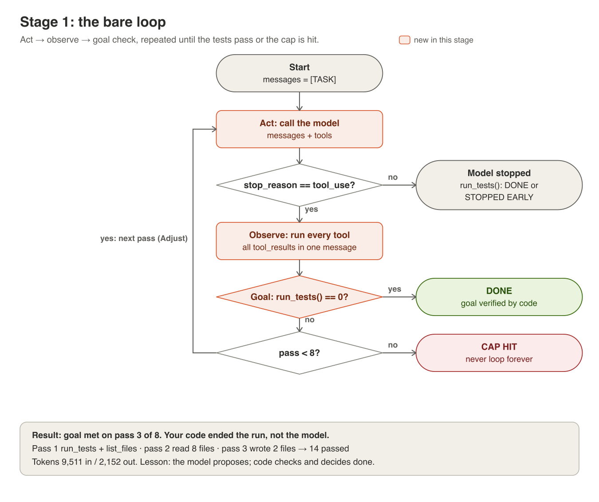

# Stage 1: the bare loop



**The idea.** An agent is a loop. Send the task and the tools to the model.
Run every tool it asks for. Send all the results back in one message, and go
again. Two things make it a harness rather than a chat: *your code* checks
the goal after every pass, and there's a hard cap, so it can't loop forever.

## In the code
| Step | Where in [harness/loop.py](../harness/loop.py) |
|---|---|
| Act | `call_model`: `messages.create` with `TOOLS` and the full history |
| Observe | `run_tool_calls`: every `tool_use` runs; all `tool_result`s go back in **one** user message, matched by id |
| Adjust | the assistant turn is appended *whole* (`response.content`, not just its text), then the next call |
| Goal | `goal.is_met()` after every pass: `run_tests().exit_code == 0` |
| Budgets | [harness/budget.py](../harness/budget.py): passes, dollars, minutes and rejected reviews, checked by the harness before every call. Running out → `ESCALATED (<reason>)`, never a silent stop |
| Trace | [harness/trace.py](../harness/trace.py): every call, tool, verdict and cost as JSON lines in `.harness/traces/` |

## Run it
Turn off every later layer:
```
python -m harness.scenario apply broken
python -m harness.loop --fresh --no-check --no-gate --no-compact | tee runs/stage1.md
```
Each pass prints the model's `stop_reason`, every tool call with its input,
and the token count. The run ends with `DONE: goal verified on pass N`, the
total cost, and the command that shows its trace:
```
python -m harness.trace show latest
```

## What to look for
- Pass 1 is usually `list_files` + `run_tests`: the model looks before it acts.
- The model never says "done". The loop stops it the moment `run_tests` passes.
- Input tokens grow every pass, because the whole history is re-sent each time.
  Stage 4 is about that.

## What happened when we ran it
[results/stage1/](../results/stage1/): goal met on pass 3 with all 4 fixes.
`piece1.txt` and `piece2.txt` show a single call and a single round trip
before the loop existed. `piece2_leaky_harness.txt` is the same round trip
before `list_files` had an allowlist: it returned 3,784 paths (3,734 of them
in `venv/`), the second call jumped from 903 to 144,349 input tokens, and the
bug patch was one `read_file` away. That run is why `tools.py` shows the
actor only three paths.

## Try this
1. **Run out of budget.** Rerun with `--max-passes 2`, then with
   `--max-cost 0.01`. Each run ends `ESCALATED (...)`: the spine is marked
   `escalated`, a note lands in `.harness/escalations.md`, and the next run
   refuses to resume without `--fresh`. That's the honest outcome. The
   harness says it didn't finish and hands it to a person.
2. **Split the results.** In `run_tool_calls`' caller, send each
   `tool_result` in its own user message instead of one. Compare how many
   tools the model asks for per pass.
3. **Drop the history.** Append only the text of the assistant turn, not
   `response.content`. The API rejects the next call: every `tool_result`
   needs a matching `tool_use` before it.
