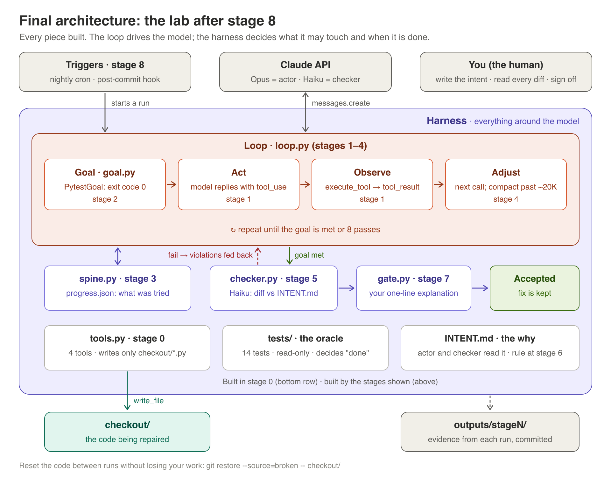

# Stage 1: the bare loop

**You learn:** what one trip around act → observe → adjust looks like in real
code, and that *your code*, not the model, decides when the work is done.

**You write:** `loop.py` at the repo root, in three small pieces. Finish and
check each piece before starting the next.



## Before you start
- The patch is applied and tagged: `git tag` shows `broken`, and
  `venv/bin/python -m pytest -q tests/` shows `4 failed, 10 passed`.
- You can call the API: `ANTHROPIC_API_KEY` is set, or `ant auth status` shows
  an active profile. `anthropic.Anthropic()` with no arguments picks up either.
- Reset the code and save the starting state:
  ```
  git restore --source=broken -- checkout/
  mkdir -p outputs/stage1 runs
  venv/bin/python -m pytest -q tests/ > outputs/stage1/tests_before.txt
  ```

## What `tools.py` gives you
| Name | Use it for |
|---|---|
| `TOOLS` | the `tools=` argument of every API call |
| `execute_tool(name, input)` | run one tool call; returns a `ToolOutcome` with `.content` (str) and `.is_error` (bool) |
| `run_tests()` | your own goal check; returns a `TestRun` with `.exit_code` (0 = all pass) and `.summary` |

---

## Piece 1: one call, no loop

**Goal:** send the task and the tools once, and look at what comes back.

Write a function that makes a single `messages.create` call and prints every
content block. The call needs:

| Argument | Value |
|---|---|
| `model` | `"claude-opus-5-5"` |
| `max_tokens` | `16000` |
| `system` | a short instruction you write: what the job is, and that it must use the tools |
| `tools` | `TOOLS` |
| `messages` | one user message with the task, e.g. "Make every test in tests/ pass." |

Then print:
- `response.stop_reason`
- for each block in `response.content`: its `type`, and for `tool_use`
  blocks, `name` and `input`
- `response.usage.input_tokens` and `response.usage.output_tokens`

Things to know about this model:
- Thinking is always on. You may see `thinking` blocks with empty text; skip
  them when printing, but don't remove them from the message history later.
- You can't force a tool (`tool_choice` "any" or "tool" returns a 400). Leave
  `tool_choice` out and ask for tool use in the system prompt.
- Always check `stop_reason` before reading content. `refusal` and `max_tokens`
  mean stop and log, not carry on.

**Check:** `stop_reason` is `tool_use`, and you see at least one `tool_use`
block, most likely `list_files` or `run_tests`. If the first call fails with a
400 about the tool schemas, tell me the exact message: the empty-object
schemas in `TOOLS` are the one part of stage 0 the API hasn't validated yet.

**Save:** the printed output → `outputs/stage1/piece1.txt`.

**Answer in notes:** why is `stop_reason` `tool_use` and not `end_turn`? Which
tool did it pick first, and why do you think it picked that one?

---

## Piece 2: one round of tool use

**Goal:** run the tool the model asked for and send the result back.

After the first response:
1. Append the assistant turn to `messages`. Use the full `response.content`,
   not just the text, so the `tool_use` and `thinking` blocks stay in the history.
2. For every `tool_use` block, call `execute_tool(block.name, block.input)`.
3. Send **all** the results back in **one** user message, one block each:
   ```python
   {"type": "tool_result", "tool_use_id": block.id,
    "content": outcome.content, "is_error": outcome.is_error}
   ```
4. Call `messages.create` again with the same arguments and the longer
   `messages`, and print the response like in piece 1.

**Check:** the second response reacts to what the tool returned. For example,
after `run_tests` it reads one of the files the failures point at. There is no
400 about `tool_use_id`.

**Save:** both responses → `outputs/stage1/piece2.txt`.

**Answer in notes:** what would break if you skipped step 1 and only sent the
tool results?

---

## Piece 3: the loop

**Goal:** repeat piece 2 until the tests pass, with a hard cap.

Wrap piece 2 in a loop:
- **Cap:** at most 8 API calls. On hitting the cap, stop and say so; never loop forever.
- **Goal check:** after each round of tool results, call `run_tests()` yourself.
  If `exit_code == 0`, stop: the goal is met.
- **Model stops first:** if `stop_reason` is `end_turn` but your check still
  fails, log it. That's the model declaring victory early, and stage 2 is
  about exactly this.
- **Log every pass:** pass number, the tools called (name + path), the test
  summary, and tokens. Write it to `runs/<timestamp>.md` as you go.

**Check:** the run ends with `14 passed` within 8 passes, or stops at the cap
and prints the pass count. Either outcome teaches something; write down which
one you got.

**Save** (from the run you keep):
```
cp runs/<your-run>.md outputs/stage1/transcript.md
git diff broken -- checkout/ > outputs/stage1/diff.patch
venv/bin/python -m pytest -q tests/ > outputs/stage1/tests_after.txt
```
Add `outputs/stage1/tokens.csv` (`pass,input_tokens,output_tokens`) if your
log has the numbers.

**Answer in notes:** who decided "done": the model's `end_turn`, or your
`exit_code` check? What happened when they disagreed, if they did?

---

## Done when
- [ ] `loop.py` runs from a fresh `git restore --source=broken -- checkout/`
- [ ] `outputs/stage1/` has `tests_before.txt`, `piece1.txt`, `piece2.txt`,
      `transcript.md`, `diff.patch`, `tests_after.txt`
- [ ] `outputs/stage1/notes.md` answers the three questions
- [ ] You can explain each change in `diff.patch` in one sentence. If you
      can't, don't accept it yet (comprehension debt)

**Don't read `diff.patch` against `stage0/inject_bugs.patch` yet.** Whether
the loop fixed bug 4 properly or just loosened the check is the stage 6
question.
