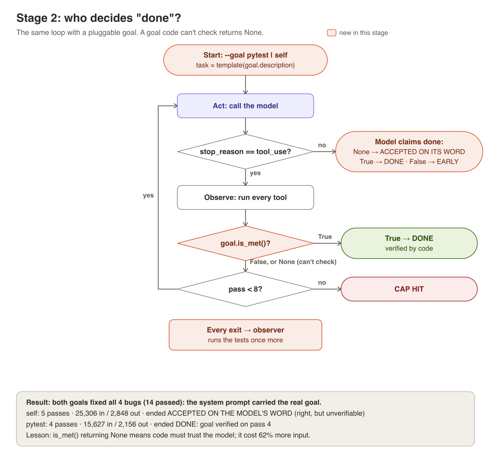

# Stage 2: a vague goal vs a goal code can check



**You learn:** "done" is a claim until something other than the model checks
it. A goal is only as good as its `is_met()`.

**You build:** `goal.py` with two goals, and `loop.py` taking `--goal`.

## The two goals
| | `SelfAssessedGoal` | `PytestGoal` |
|---|---|---|
| Words the model sees | "Make the checkout service better." | "Every test in tests/ passes." |
| `is_met()` returns | `None`: code cannot judge "better" | `True` / `False` from `run_tests()` |
| Who ends the loop | the model, by stopping | your code |

`is_met()` returning `None` is the video's "be happier" resolution in code:
the loop can only wait for the model to stop and take its word for it.

## Steps
1. Write `goal.py`: a `Goal` protocol (`name`, `description`, `is_met()`), the
   two goals, and a `GOALS` dict keyed by name.
2. In `loop.py`, turn `TASK` into a template with a `{goal}` slot, so only the
   goal sentence differs between runs. Hold everything else constant.
3. Replace the hard-coded `run_tests()` checks with `goal.is_met()`, and handle
   all three answers: `True` stop, `False` continue, `None` wait for the model.
4. After the loop, always run the tests once more as an **outside observer**,
   so both runs are measured the same way.
5. Write down two predictions before running: will the vague goal fix the 4
   bugs? Will it stop sooner or later, and change more?
6. Run both, each from the broken baseline:
   ```
   git restore --source=broken -- checkout/ && venv/bin/python loop.py --goal self | tee runs/stage2-self.md && git diff broken -- checkout/ > runs/stage2-self.diff
   git restore --source=broken -- checkout/ && venv/bin/python loop.py --goal pytest | tee runs/stage2-pytest.md && git diff broken -- checkout/ > runs/stage2-pytest.diff
   ```

## Save to `outputs/stage2/`
`run_self.md`, `run_pytest.md`, `diff_self.patch`, `diff_pytest.patch`,
`tokens.csv`, `comparison.md` (the side-by-side table), and your `notes.md`.

## Questions for your notes
1. Were your predictions right? If the vague goal still fixed the bugs, what
   in the model's context was really steering it?
2. From inside the loop, could you tell run A's success from a failure? What
   told you it succeeded?
3. Where did the extra tokens in the self-assessed run go?

## Optional: stage 2b
Remove the oracle from the system prompt too (no mention of tests) and rerun
`--goal self`. This is where a self-assessed loop should visibly drift.

**Our result:** see [outputs/stage2/comparison.md](../outputs/stage2/comparison.md).
