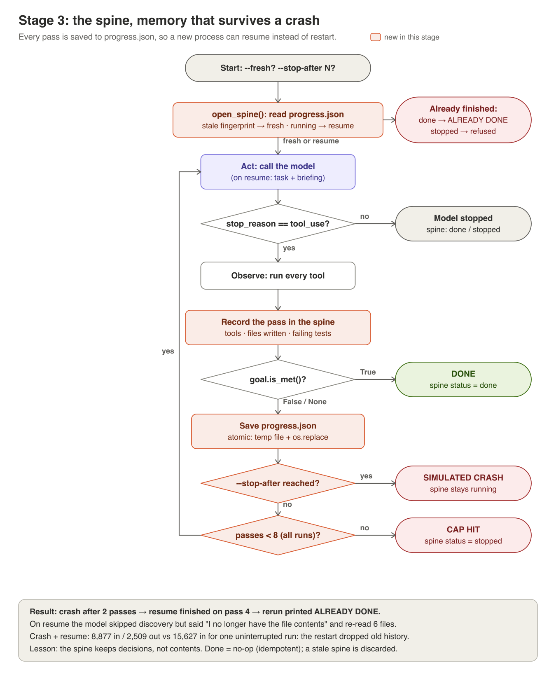

# Stage 3: the spine, memory that survives a crash



**The idea.** A crash loses the whole API conversation. The spine is a small
file, written after every pass, that keeps what was *learned* (which tests
fail, which files were written, which tools ran), not what was *read*. A new
process reads it, briefs the model, and carries on instead of starting over.
The model can always re-read a file; it can't recover a decision.

## In the code
| Piece | Where in [harness/spine.py](../harness/spine.py) |
|---|---|
| What's kept per pass | `PassRecord`: tool calls, files written, failing tests, tokens, checker and gate verdicts |
| Atomic save | `save_spine`: write a temp file, then `os.replace`, so a crash mid-save keeps the old spine |
| Stale detection | `fingerprint_code`: a hash of `checkout/*.py`; if the code changed under the spine, its record is no longer true |
| The briefing | `progress_note`: what the model reads in place of its lost conversation |
| Resume rules | [harness/loop.py](../harness/loop.py) `open_spine`: resume, start fresh, or refuse (`ALREADY DONE`, `STOPPED BEFORE`, `ESCALATED BEFORE`) |

The spine lives in `.harness/progress.json`, which the actor can't see.

## Run it
Crash on purpose after 2 passes, then resume without resetting the code:
```
python -m harness.scenario apply broken
python -m harness.loop --fresh --stop-after 2 --no-check --no-gate --no-compact | tee runs/stage3-crash.md
cat .harness/progress.json
python -m harness.loop --no-check --no-gate --no-compact | tee runs/stage3-resume.md
python -m harness.loop --no-check --no-gate --no-compact      # ALREADY DONE: no API call
```

## What to look for
- After the crash, `"status": "running"` and the failing test ids.
- The resume prints `RESUMING from progress.json at pass 3`, and the model's
  first message says what it's skipping.
- The third run makes no API call at all.

## What happened when we ran it
[results/stage3/comparison.md](../results/stage3/comparison.md): the resume
skipped `list_files` and `run_tests` and finished on pass 4. The model said,
unprompted, "I no longer have the file contents, so I'll re-read them". The
interrupted job used **43% less input** than the uninterrupted one, because
the restart dropped the old history.

## Try this
1. **Edit under the spine.** Crash after 2 passes, change any line in
   `checkout/`, then resume. You'll see `STALE SPINE`: the fingerprint
   caught it.
2. **Corrupt it.** Truncate `.harness/progress.json` halfway and resume. A
   bad spine is ignored, never a crash.
3. **Keep more.** Add the assertion message of each failing test to
   `PassRecord` and the briefing. Does the resumed model re-read fewer files?
