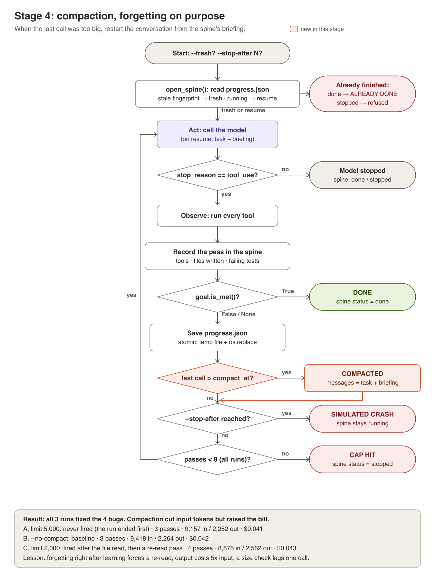

# Stage 4: context, forgetting on purpose



**The idea.** Every pass re-sends the whole conversation, so each call costs
more than the last. Compaction throws the conversation away once a call gets
too big and restarts it from the spine's briefing. It's forgetting on
purpose. The question isn't whether it saves input tokens; it's whether it
saves *money and passes*.

## In the code
| Piece | Where in [harness/loop.py](../harness/loop.py) |
|---|---|
| The trigger | after each pass: `response.usage.input_tokens > compact_at` |
| The restart | `compact_history`: one user message, the task plus `progress_note(spine)` |
| What can't be forgotten | a checker or gate rejection is appended *after* compaction, so it survives |
| The record | `PassRecord.compacted = True` on the pass that triggered it |

## Run it
Three runs, only the limit changes:
```
python -m harness.scenario apply broken
python -m harness.loop --fresh --no-compact --no-check --no-gate | tee runs/stage4-none.md
python -m harness.scenario apply broken
python -m harness.loop --fresh --compact-at 5000 --no-check --no-gate | tee runs/stage4-5000.md
python -m harness.scenario apply broken
python -m harness.loop --fresh --compact-at 2000 --no-check --no-gate | tee runs/stage4-2000.md
grep -E "^tokens|COMPACTED|total tokens" runs/stage4-*.md
```

## What to look for
- When `COMPACTED` fires, and what the model does on the next pass.
- Input *and* output totals. Output costs about 5× as much as input.

## What happened when we ran it
[results/stage4/comparison.md](../results/stage4/comparison.md): compacting
at 2,000 cut input by 6% but added 13% output and one extra pass, so it was
the **most expensive** of the three runs. It fired right after the model had
read 8 files, and the model's next move was to re-read them. At 5,000 it
never fired: the only big call was the one that met the goal, and a size
check can only shrink the *next* call.

## Try this
1. **Compact later.** Find the limit at which compaction fires *after* the
   fixes are written, not just after the reads. Is that run cheaper than no
   compaction?
2. **A better briefing.** `progress_note` lists file names only. Add a
   one-line summary of what each failing test checks, then rerun at 2,000.
   Does the re-read go away?
3. **Price it.** Write a 10-line script that reads a transcript's `tokens:`
   lines and prints its cost at $2/M input and $10/M output. Measure
   compaction in money, not in input tokens.
