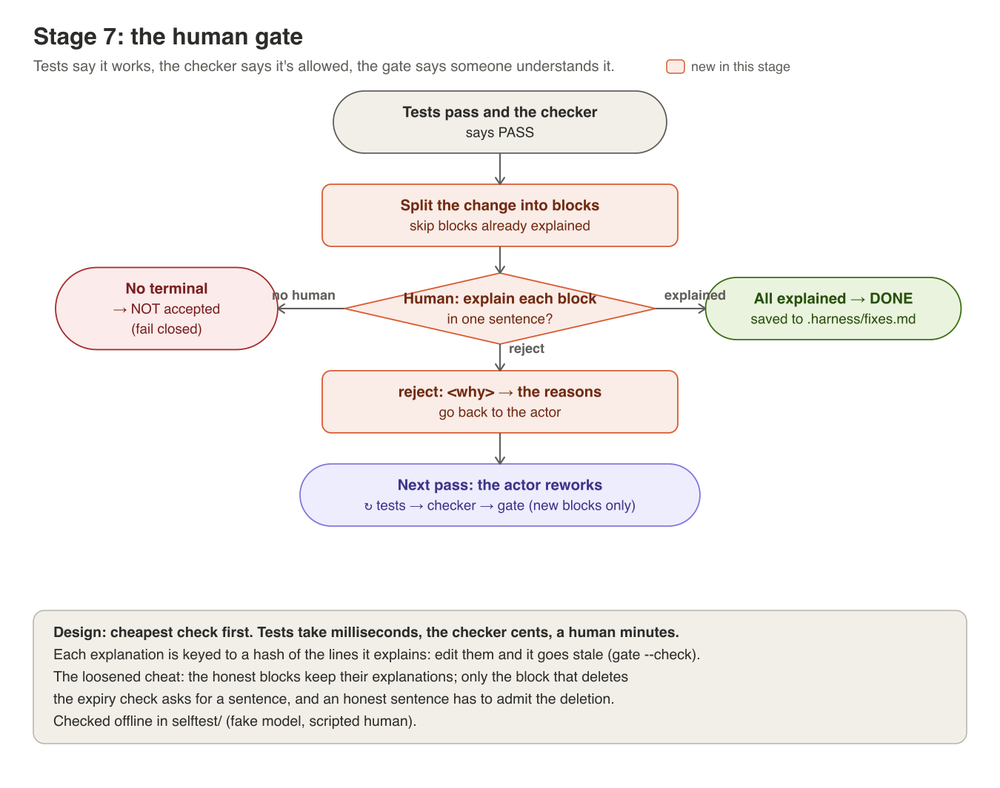

# Stage 7: the human gate



**The idea.** The tests say the code *works*, the checker says the change
is *allowed*, and neither says anyone *understands* it. Code that's merged
and nobody can explain is comprehension debt: it passes today, and when it
breaks nobody knows why. The gate is the cheapest check of understanding
there is. Before a change is accepted, a human explains each part of it in
one sentence, or rejects it with a reason the actor can act on.

**Order matters.** Tests (milliseconds, free), then the fixed rules
(milliseconds, free), then the checker (seconds, cents), then the human
(minutes, attention). Never spend a human on a change a machine would have
rejected.

## In the code
| Piece | Where in [harness/gate.py](../harness/gate.py) |
|---|---|
| Blocks, not hunks | `hunks`: splits the diff into change blocks, even when git merged two of them into one hunk |
| Stable ids | each block is keyed by its file plus a hash of its +/- lines, so an explanation sticks to the code it explains |
| One sentence | `problem_with`: at least 6 words, one sentence. If it needs two, the change may be doing two things |
| Reject | `reject: <why>` → `feedback_for_actor`, sent back like a checker failure |
| Fails closed | `GateUnavailable` with no terminal: the change is not accepted |
| Only what's new | `unexplained`: a rework asks only about blocks nobody has explained yet |
| In the loop | [harness/loop.py](../harness/loop.py) `review_change`: fixed rules, then checker, then the gate; each verdict goes into the spine and the trace |

Explanations are kept in `.harness/fixes.md`.

## Run it
The full harness, with every layer on:
```
python -m harness.scenario apply broken
python -m harness.loop --fresh | tee runs/stage7.md
```
Explain each block in business words: *why* the change is right, not what
the line now says. "Rounds half-up" restates the code; "a half paisa is
charged to the customer, never dropped" explains it.

Then try the gate on its own:
```
python -m harness.gate --check                       # every block explained? exit 0 or 1
python -m harness.gate --diff scenarios/cheats/loosened.patch --fixes runs/cheat.md
```

## What to look for
- Reject one block (`reject: justify this from INTENT.md`). The next pass
  reworks it, and the gate asks you about **only** that block.
- The loosened cheat: the min-spend fix and the deleted expiry check land in
  one block. Try to explain it in one honest sentence. What does it have to
  admit?

## What happened when we ran it
Checked offline in [selftest/test_loop.py](../selftest/test_loop.py) and
[selftest/test_layers.py](../selftest/test_layers.py), with a fake model and
a scripted human. A rejection reaches the actor, and only the reworked block
comes back. Explanations go stale when their lines change. With no terminal,
nothing is accepted. There's no recorded model run in `results/` yet; yours
can be the first.

## Try this
1. **Stale on purpose.** After an accepted run, change one line inside a
   block you explained, then `python -m harness.gate --check`. It fails on
   exactly that block. Undo the change and it passes. A git pre-commit hook
   running this check means no unexplained change gets committed.
2. **Too easy to satisfy?** Lower `MIN_WORDS` to 1 and see what you end up
   accepting. Raise it to 15. Where is the line between friction and rubber
   stamp?
3. **Who should get `--no-gate`?** Stage 8 uses it on purpose. List the runs
   that should never use it, and write the reason in one sentence each.
