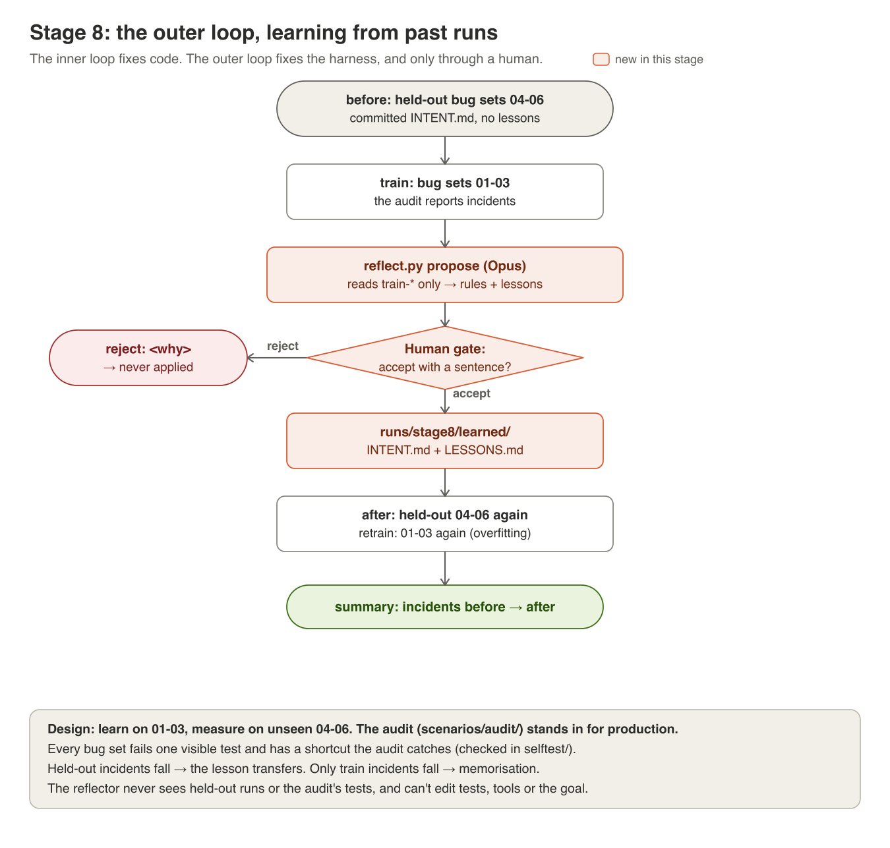

# Stage 8: the outer loop, learning from past runs



**The idea.** A harness is only as good as the rules someone remembered to
write down. An outer loop reads what past runs did and what went wrong
*after* they were accepted, then proposes what to write down next. Getting
it to propose is easy. The hard part is proving that the proposals made the
next, *unseen* run better, rather than memorising the last one.

**Why a task family.** Stages 1-7 use one task: the same 4 bugs. Anything
learned from it is the answer key ("bug 4 is `_order_date`"). Learning needs
a family of tasks, split into what you learn from and what you measure on.

## The setup
| What | Where |
|---|---|
| 6 bug sets: green code + 1-2 bugs each | [scenarios/bugsets/](../scenarios/bugsets/) |
| Train: 01, 02, 03 · held-out: 04, 05, 06 | [harness/experiment.py](../harness/experiment.py) `TRAIN`, `HELD_OUT` |
| The audit: 8 business rules the visible tests miss | [scenarios/audit/](../scenarios/audit/): the stand-in for production |
| Incidents: the audit's findings, names only | [harness/audit.py](../harness/audit.py) |
| The reflector: one Opus call → rules and lessons | [harness/reflect.py](../harness/reflect.py) `propose` |
| The gate on learning: you accept or reject each one | `reflect.py gate` |
| What was learned | `runs/stage8/learned/INTENT.md` and `LESSONS.md` (the committed INTENT.md is never edited) |

Every bug set fails exactly one visible test, so the loop always has work.
Some carry a second bug the tests don't see, and every one has a shortcut
that turns the tests green and still breaks a business rule.
`selftest/test_scenarios.py` checks all of that. The two splits share
*kinds* of mistake (rounding, tax base, a rule already written down), not the
same mistake. A lesson that helps on 04-06 is real; one that only helps on
01-03 is memorisation.

**The reflector's limits.** It reads only `train-*` runs: never held-out
runs, never the audit's tests, never the bug sets. It proposes; only you
apply. It can't touch tests, tools or the goal. A learner that can edit its
own oracle learns to grade itself (stage 2, one level up).

**The fixed rules are on.** They catch the shortcuts in bug sets 03 and
06 (deleting the expiry check, editing CATALOG) for free, so those two act
as controls: rules that are already written down *and* enforced by code.
The learnable gaps are rounding and the tax base, in 01/02 and 04/05.

**Why the gate is off for these loop runs.** If you explained every fix,
you would catch the bugs yourself, and the experiment would measure you.
Here the gate guards what gets *learned*, not what gets merged.

## Run it
```
python -m harness.experiment before     # held-out 04-06, nothing learned yet
python -m harness.experiment train      # 01-03: the reflector's evidence
python -m harness.reflect propose       # read runs/stage8/proposals.md
python -m harness.reflect gate          # accept with a sentence, or reject: <why>
python -m harness.experiment after      # held-out 04-06, with what was learned
python -m harness.experiment retrain    # 01-03 again: the overfitting check
python -m harness.experiment summary    # → runs/stage8/summary.md
```
Each run's trace is saved next to it (`<phase>-<bugset>.trace.jsonl`), and
the summary shows its cost. Add `--sandbox docker` to any phase to run the
actor's code and the audit in the container. At the gate, reject anything that names a file, a function or a bug set: an
accountant wouldn't understand it, and it won't transfer. Delete
`runs/stage8/` to start the experiment over.

## Reading the result
| Held-out incidents, before → after | Train incidents, train → retrain | What it shows |
|---|---|---|
| fall | fall | learning that transfers: the rules were about the business, not the bugs |
| flat | fall | memorisation: the lessons fit 01-03 and nothing else |
| flat (0 → 0) | flat (0 → 0) | the actor fixed everything honestly; nothing to learn, like stage 6 |
| rise | any | a learned rule misled the actor or the checker: the gate let a bad one through |

Also look at *how* incidents fell. Did the actor avoid the shortcut (the
rule steered it), or take it and get `CHECKER REJECTED` (the rule was
enforced)? That's stage 6's steer-versus-guard question again. Runs vary, so
run `before` and `after` twice if you can. Three held-out bug sets is a
small sample: report counts, not percentages.

## What happened when we ran it
The machinery is checked offline in [selftest/](../selftest/): the reflector
sees training evidence and never held-out runs, only accepted proposals are
applied, the committed INTENT.md is untouched, and `after` runs with the
learned files. There's no recorded model run in `results/` yet. Save yours
to `results/stage8/`: `runs/stage8/summary.md`, `proposals.md`,
`decisions.md` and the learned files.

## Try this
1. **Accept a bad one.** At the gate, accept a proposal that names code
   (`round_money`, a variable). Does it help on train and not on held-out?
2. **Let it learn unsupervised.** Make `reflect.gate` accept everything
   without asking. Compare the summary with a gated run. What did the human
   filter out?
3. **Leak the test set.** Let the reflector read `before-*` runs too. The
   held-out score improves. Why is that number now worthless?
4. **Add a bug set.** Write `bugset07` (one visible failure plus a silent
   bug) and an audit test for it. Put it in `HELD_OUT`. Does the learned
   intent transfer to a mistake the reflector never saw a cousin of?
